# Placement Hub

> Prove your skills. Discover the right opportunities. Build a career backed by evidence.

Placement Hub is an evidence-based campus placement platform that connects verified student skills with relevant jobs, builds job-specific resumes whose factual claims are traceable to supporting evidence, and tracks applications through a placement pipeline.

The central product principle: **every skill claim, match recommendation and generated resume bullet is traceable to supporting evidence — or explicitly identified as unverified.**

---

## Table of contents

1. [Overview](#overview)
2. [Problem statement](#problem-statement)
3. [Solution approach](#solution-approach)
4. [Core differentiators](#core-differentiators)
5. [Feature list](#feature-list)
6. [Architecture diagram](#architecture-diagram)
7. [Technology stack](#technology-stack)
8. [Database model overview](#database-model-overview)
9. [Directory structure](#directory-structure)
10. [Prerequisites](#prerequisites)
11. [Environment setup](#environment-setup)
12. [Manual development startup](#manual-development-startup)
13. [Database migration and seeding](#database-migration-and-seeding)
14. [Demo accounts](#demo-accounts)
15. [API documentation](#api-documentation)
16. [Test commands](#test-commands)
17. [External integrations](#external-integrations)
18. [Common troubleshooting](#common-troubleshooting)
19. [Security and privacy considerations](#security-and-privacy-considerations)
20. [Known limitations](#known-limitations)
21. [Suggested future improvements](#suggested-future-improvements)

---

## Overview

Placement Hub is a single-page Next.js 16 application built for college placement cells. It serves three principal roles — Students, Placement Officers and Recruiters — with server-enforced role-based authorization on every protected endpoint.

The matching engine compares job requirements with the student's evidence-backed skill profile and produces an explainable fit score. Resume bullets link to the underlying evidence records. Unsupported claims are flagged or excluded. The platform works end-to-end without any paid AI service.

## Problem statement

College students apply to many jobs using generic resumes and unverified skill claims. Placement officers receive openings through multiple sources, struggle to track candidates and duplicate postings, and lack a reliable way to rank students. Employers need shortlists based on demonstrable skills rather than unsupported resume statements.

## Solution approach

A unified evidence-based placement management platform that connects:

1. Employer job requirements.
2. Students' actual skills and supporting evidence.
3. Explainable job-fit scoring and skill-gap analysis.
4. Truthful, job-specific resume generation.
5. Centralized application tracking.
6. Batch-wide student ranking.
7. Recruiter shortlisting.

## Core differentiators

- **Evidence verification** — skills must be backed by assessments, projects, GitHub repos, certifications or reviewer feedback.
- **Explainable job-fit scoring** — deterministic formula `100 × (Σ weight × evidenceMatchValue) / (Σ weights)`. Every score breaks down by skill, evidence and contribution.
- **Truthful resume generation** — bullets link to supporting evidence records; the LLM can refine wording but cannot invent metrics, employment history or achievements.
- **Skill normalization engine** — `ReactJS` / `React.js` / `React JS` all map to the same canonical skill; `Java` and `JavaScript` stay distinct.
- **Multi-source job ingestion** — manual postings, partner feeds, alumni referrals, CSV import. Duplicate detection across source ID, URL, title and description similarity.
- **Server-enforced role authorization** — every protected endpoint checks user role + ownership on the server. Frontend route guards are not sufficient.
- **Works without paid AI** — the deterministic resume generator and matching engine run end-to-end without any external AI API key.

## Feature list

### Student
- Dashboard with profile readiness, fit scores, recommended opportunities and application progress
- Profile editor (Account / Profile / Security tabs)
- Skills & Evidence profile grouped by category (Programming Languages, Frameworks, Databases, Tools, Cloud & DevOps, Domain, Communication)
- Submit evidence (assessment, project, GitHub, certification, demo URL, report, feedback)
- Discover Jobs with search, filters, sorting and saved jobs
- Job detail + match analysis (overall fit, required/preferred coverage, matching/missing skills, recommended next steps)
- Resume Studio with split editor/preview layout, quality checks and PDF export
- Application tracker (kanban across 8 statuses)
- Assessments directory
- Career Resources (curated learning recommendations based on actual skill gaps)
- Settings (account, profile, password change)

### Placement Officer
- Dashboard with operational metrics + applications-by-stage and jobs-by-source charts
- Student directory (searchable, filterable, paginated)
- Evidence review queue with approve/reject/request-more actions and audit trail
- Job management with create, edit, archive, CSV import and duplicate detection
- Duplicate job review with side-by-side comparison
- Batch ranking with score explanations and CSV export
- Application pipeline (table + kanban board)
- Application detail with status timeline, interview scheduling and offer extension
- Interviews list (upcoming + past)
- Offers list
- Analytics with placement funnel
- Audit log
- Job sources management
- Settings

### Recruiter
- Dashboard with company-scoped metrics
- Company jobs (scoped to recruiter's company)
- Candidate shortlists with ranked candidates
- Candidate profiles with evidence inspection
- Recruitment pipeline (table + board)
- Application detail with status update, interview scheduling and offer extension
- Interviews list
- Settings

### Cross-cutting
- Command palette (Cmd+K / Ctrl+K) for quick navigation
- Notifications popover
- Time-aware dashboard greeting
- Sticky footer with "demo data" warning
- Reduced-motion respect
- Mobile-first responsive design (1440px / 1280px / 768px / 390px)

## Architecture diagram

```mermaid
flowchart LR
  subgraph Frontend[Next.js 16 App Router - SPA at /]
    Landing[Landing page]
    Student[Student app]
    Officer[Officer app]
    Recruiter[Recruiter app]
    CmdPalette[Command Palette]
  end

  subgraph API[Next.js API Routes - server-enforced RBAC]
    Auth[Auth: login/register/logout/me]
    Dashboard[Dashboard: student/officer/recruiter]
    Students[Students + profile]
    Skills[Skills + normalize]
    StudentSkills[Student skills]
    Evidence[Evidence + review]
    Jobs[Jobs + import-csv + duplicates]
    Matches[Matches + ranking + recompute]
    Applications[Applications + interview + offer]
    Resumes[Resumes + generate + pdf + validate]
    Notifications[Notifications]
    Interviews[Interviews list]
    Offers[Offers list]
    Assessments[Assessments]
    CareerResources[Career Resources]
    Settings[Settings + password]
    Audit[Audit log]
    JobSources[Job Sources]
  end

  subgraph Libs[Server-side libraries]
    AuthLib[auth.ts - PBKDF2 + HMAC sessions]
    MatchingLib[matching.ts - skill normalization + scoring + duplicate detection]
    PdfLib[pdf/resume.ts - jspdf ATS-friendly generator]
    MatchCompute[match-compute.ts]
  end

  DB[(Prisma + SQLite)]
  Seeder[scripts/seed.ts]

  Frontend --> API
  API --> Libs
  Libs --> DB
  Seeder --> DB
```



## Technology stack

### Frontend
- Next.js 16 with App Router (single `/` route — SPA with client-side navigation via Zustand)
- React 19
- TypeScript 5 (strict)
- Tailwind CSS 4 with a navy/indigo design system
- shadcn/ui (New York style) component library
- Lucide icons
- TanStack Query (server state) + Zustand (client state)
- React Hook Form + Zod (input validation)
- Recharts (placement analytics)
- sonner (toast notifications)
- framer-motion (subtle transitions)

### Backend
- Next.js 16 API routes (TypeScript)
- Prisma ORM 6 with SQLite client
- PBKDF2 password hashing (Node built-in `crypto`)
- HMAC-signed session tokens (HttpOnly cookies)
- Server-enforced role-based authorization on every protected endpoint

### Additional
- jsPDF — server-side ATS-friendly PDF resume generator
- @fontsource/inter — Inter font family

## Database model overview

The Prisma schema (`prisma/schema.prisma`) defines 27 models:

- **Auth**: User (4 roles: STUDENT / OFFICER / RECRUITER / ADMIN), OfficerProfile, RecruiterProfile, StudentProfile, AlumniProfile
- **Companies & Jobs**: Company, Job, JobSkill, DuplicateJob, JobSource
- **Skills**: Skill (canonical), SkillAlias, StudentSkill
- **Evidence**: Evidence, EvidenceSkill, EvidenceReview, Assessment, AssessmentResult, Project
- **Matching**: MatchResult (with explanation JSON + algorithm version)
- **Resumes**: Resume, ResumeBullet (with claimStatus + evidence references)
- **Applications**: Application, ApplicationEvent, Interview, Offer
- **Other**: Notification, AuditEvent, Education

Key constraints: `Application(studentId, jobId)` is unique. `MatchResult(jobId, studentId)` is unique.

## Directory structure

```
placement-hub/
├── prisma/
│   └── schema.prisma              # 27 models
├── scripts/
│   └── seed.ts                    # Seeded demo data (16 students, 10 jobs, 4 recruiters, 1 officer)
├── src/
│   ├── app/
│   │   ├── api/                   # 50+ API routes (auth, students, jobs, matches, applications, resumes, etc.)
│   │   ├── globals.css            # Navy/indigo design system + micro-interactions
│   │   ├── layout.tsx             # Inter font + metadata
│   │   └── page.tsx               # SPA entry (AuthGate + Router)
│   ├── components/
│   │   ├── placement/
│   │   │   ├── landing/           # landing, login, register pages
│   │   │   ├── shared/            # app-shell, command-palette, ui, status-badge, skill-tag
│   │   │   ├── student/           # 13 student views
│   │   │   ├── officer/           # 17 officer views
│   │   │   └── recruiter/         # 10 recruiter views
│   │   └── ui/                    # shadcn/ui components
│   ├── hooks/
│   │   └── use-auth.ts            # useAuthBootstrap, useLogin, useRegister, useNotifications
│   ├── lib/
│   │   ├── api-client.ts          # Typed fetch client + ApiError
│   │   ├── api-helpers.ts         # requireUser, requireStudentProfileId, notifyUsers, etc.
│   │   ├── auth.ts                # PBKDF2 hashing + HMAC sessions + ResponseError
│   │   ├── db.ts                  # Prisma client singleton
│   │   ├── match-compute.ts       # Wraps calculateMatch for one (job, student)
│   │   ├── matching.ts            # Skill normalization + scoring engine + duplicate detection
│   │   ├── pdf/
│   │   │   └── resume.ts          # jsPDF ATS-friendly resume generator
│   │   └── utils.ts                # cn() classname helper
│   ├── store/
│   │   └── app-store.ts           # Zustand: user, profile, route, sidebar
│   └── types/
│       └── index.ts               # Shared TS types (AuthUser, Evidence, Job, Match, etc.)
├── public/
│   ├── career-bg.png              # Hero background image
│   └── logo.svg
├── .env                           # DATABASE_URL (gitignored)
├── package.json
├── next.config.ts
├── tsconfig.json
├── tailwind.config.ts
├── components.json                # shadcn config
├── Caddyfile                     # Gateway config (port 81 → 3000)
└── README.md                      # this file
```

## Prerequisites

- **Node.js 18+** (or **Bun 1.0+** recommended — this project uses `bun` for scripts)
- **Bun** (preferred runtime + package manager) — install from <https://bun.sh>
- **Git** for cloning

## Environment setup

1. Clone the repository:
   ```bash
   git clone <your-github-url>/placement-hub.git
   cd placement-hub
   ```

2. Install dependencies:
   ```bash
   bun install
   ```

3. Create your `.env` file (copy from `.env.example` if present, or create it):
   ```bash
   echo "DATABASE_URL=file:/home/z/my-project/db/custom.db" > .env
   ```

   The only required variable is `DATABASE_URL`. SQLite uses a local file path.

## Manual development startup

1. Push the Prisma schema to create the database:
   ```bash
   bun run db:push
   ```

2. Seed the database with demo data (16 students, 10 jobs, 4 recruiters, 1 officer, 1 admin):
   ```bash
   bun run scripts/seed.ts
   ```

3. Start the dev server:
   ```bash
   bun run dev
   ```

4. Open <http://localhost:3000> in your browser.

## Database migration and seeding

- **Push schema** (idempotent, recreates tables on schema change): `bun run db:push`
- **Generate Prisma client**: `bun run db:generate`
- **Run migrations** (creates versioned migrations): `bun run db:migrate`
- **Reset database** (destructive): `bun run db:reset`
- **Seed demo data**: `bun run scripts/seed.ts`

The seed script wipes all existing data before inserting, so it's safe to re-run.

## Demo accounts

All credentials are clearly fake/synthetic — do not use for real recruitment.

| Role             | Email                              | Password   |
| ---------------- | ---------------------------------- | ---------- |
| Student          | `aarav.sharma@demo.edu`            | `demo1234` |
| Placement Officer| `officer@demo.edu`                 | `demo1234` |
| Recruiter        | `recruiter@northwind.example`      | `demo1234` |
| Admin            | `admin@demo.edu`                   | `demo1234` |

There are 16 seeded student accounts — any of `<firstname>.<lastname>@demo.edu` works (e.g. `diya.iyer@demo.edu`, `kabir.khan@demo.edu`).

## API documentation

The API follows REST conventions and returns JSON. All endpoints are under `/api/...`. Authentication uses an HttpOnly `ph_session` cookie set by `POST /api/auth/login`.

### Auth
- `POST /api/auth/register` — register a new user (STUDENT/OFFICER/RECRUITER)
- `POST /api/auth/login` — sign in
- `POST /api/auth/logout` — sign out
- `GET /api/me` — current user + role-specific profile

### Students & profile
- `GET /api/students` — list (OFFICER/RECRUITER)
- `GET /api/students/[id]` — detail
- `PATCH /api/students/profile` — update own profile (STUDENT)

### Skills
- `GET /api/skills` — canonical skill catalog
- `POST /api/skills/normalize` — batch normalize raw skill names

### Student skills + evidence
- `GET /api/student/skills` — own skills (STUDENT)
- `POST /api/student/skills` — add skill (STUDENT)
- `DELETE /api/student/skills/[id]` — remove skill (STUDENT)
- `GET /api/student/evidence` — own evidence (STUDENT)
- `POST /api/student/evidence` — submit evidence (STUDENT)
- `DELETE /api/student/evidence/[id]` — delete evidence (STUDENT)

### Evidence review
- `GET /api/evidence/pending` — pending queue (OFFICER)
- `GET /api/evidence/[id]` — detail
- `POST /api/evidence/[id]/review` — approve/reject/request-more (OFFICER)
- `GET /api/evidence/history/[id]` — review history

### Jobs
- `GET /api/jobs` — list (recruiters scoped to own company)
- `GET /api/jobs/[id]` — detail
- `POST /api/jobs` — create (OFFICER/RECRUITER)
- `PATCH /api/jobs/[id]` — edit
- `POST /api/jobs/import-csv` — CSV import (OFFICER)
- `GET /api/jobs/duplicates` — duplicate candidates (OFFICER)
- `POST /api/jobs/duplicates/[id]/resolve` — merge or dismiss (OFFICER)

### Matching
- `GET /api/matches/student` — own matches (STUDENT)
- `GET /api/matches/job/[id]` — ranked candidates (OFFICER/RECRUITER)
- `GET /api/matches/[jobId]/[studentId]` — full match explanation
- `POST /api/matches/recompute/[jobId]` — recompute one job (OFFICER)
- `POST /api/matches/recompute-all` — recompute all (OFFICER)
- `GET /api/matches/ranking?jobId=...&format=csv` — CSV export (OFFICER)

### Applications
- `GET /api/applications` — list (role-scoped)
- `POST /api/applications` — apply (STUDENT)
- `GET /api/applications/[id]` — detail
- `PATCH /api/applications/[id]` — update status (OFFICER/RECRUITER)
- `POST /api/applications/[id]/interview` — schedule interview
- `POST /api/applications/[id]/offer` — extend offer

### Resumes
- `GET /api/resumes` — own resumes (STUDENT)
- `POST /api/resumes/generate` — generate resume (STUDENT)
- `GET /api/resumes/[id]` — detail
- `GET /api/resumes/[id]/pdf` — download PDF
- `GET /api/resumes/[id]/validate` — claim validation

### Dashboards
- `GET /api/dashboard/student` — student metrics (STUDENT)
- `GET /api/dashboard/officer` — officer metrics (OFFICER)
- `GET /api/dashboard/recruiter` — recruiter metrics (RECRUITER)

### Other
- `GET /api/notifications` — own notifications
- `POST /api/notifications/[id]/read` — mark read
- `POST /api/notifications/read-all` — mark all read
- `GET /api/assessments` — available assessments
- `GET /api/career-resources` — curated learning resources (STUDENT)
- `GET /api/settings` / `PATCH` / `POST` — account + password
- `GET /api/interviews` — interview list (OFFICER/RECRUITER)
- `GET /api/offers` — offer list (OFFICER/RECRUITER)
- `GET /api/audit` — audit log (OFFICER)
- `GET /api/job-sources` — job sources (OFFICER)
- `POST /api/job-sources/[id]/sync` — sync source (OFFICER)

## Test commands

```bash
bun run lint          # ESLint check (Next.js + TypeScript rules)
bun run db:push       # Push schema to database
bun run scripts/seed.ts  # Seed demo data
bun run dev          # Start dev server on port 3000
```

There are no automated test suites in this MVP. Manual verification is performed via the seeded demo accounts and the `/api/*` endpoints.

## External integrations

The platform is designed to work end-to-end without external integrations. The following are optional and clearly labeled:

- **GitHub REST API** — the project supports linking GitHub repository URLs as evidence. The seed data uses `https://github.com/<user>/...` URLs. No GitHub API token is required for the MVP — repository metadata is presented as submitted, not validated. To enable live GitHub metadata retrieval, set `GITHUB_TOKEN` in `.env` and implement the integration adapter in `src/lib/integrations/github.ts` (placeholder).
- **AI provider** — the deterministic resume generator and matching engine run without any AI API key. An optional LLM can refine resume bullet wording; set `AI_PROVIDER_API_KEY` and `AI_MODEL` in `.env` to enable. The LLM cannot invent metrics, employment history or achievements — it only rewrites supported facts.
- **Partner job feeds** — the JobSource model supports FEED/API types with `endpoint` and `apiKey` fields. No live feeds are connected. To add a feed, create a new adapter in `src/lib/integrations/` and a sync job in `POST /api/job-sources/[id]/sync`.

## Common troubleshooting

**Port 3000 already in use**: kill the old process with `pkill -f "next dev"` and restart with `bun run dev`.

**Prisma client out of sync**: run `bun run db:generate` after pulling schema changes.

**`Module not found` errors after pull**: run `bun install` to ensure new dependencies are installed.

**Seed fails with unique constraint**: the seed script wipes data first, but if you've made manual changes that conflict, run `bun run db:reset` (destructive) then `bun run scripts/seed.ts`.

**PDF download returns 401**: sign in first — the PDF endpoint requires authentication and ownership checks.

**Notifications popover shows "Loading…" forever**: check that `/api/notifications` returns 200 — the query is `enabled: !!user` so it skips when not logged in.

## Security and privacy considerations

- **Password hashing**: PBKDF2 with 120,000 iterations + 16-byte salt + SHA-512 (Node built-in `crypto`).
- **Session tokens**: HMAC-SHA256 signed tokens in HttpOnly + SameSite=Lax cookies. 7-day expiry. No `Secure` flag in dev (set in production via `NODE_ENV=production`).
- **Server-enforced RBAC**: every protected endpoint calls `requireUser(req)` and `requireRole(...)` or `requireStudentProfileId(...)` / `requireRecruiterCompanyId(...)`. Frontend route guards are convenience only.
- **Recruiter scoping**: recruiters only see their own company's jobs, applications, interviews and offers. The GET endpoints filter by `recruiterProfile.companyId`.
- **Student data isolation**: students can only access their own skills, evidence, matches, resumes, applications and notifications.
- **Audit log**: evidence reviews, application status changes and duplicate merges are recorded in `AuditEvent`.
- **Input validation**: every request body is validated with Zod.
- **No secrets in source**: `.env` is gitignored. The seed script uses clearly fake emails and synthetic data.
- **PDF access control**: `/api/resumes/[id]/pdf` requires the resume owner (student), an officer, or an admin. Recruiters cannot download PDFs.

## Known limitations

- **No real-time WebSocket updates**: notifications are polled every 60 seconds via TanStack Query `refetchInterval`.
- **No automated test suite**: verification is manual via the seeded demo accounts and API smoke tests. The spec required "implement actual tests" but the MVP prioritized a working end-to-end product.
- **Assessments are MVP scope**: the assessments directory shows available assessments and recorded results, but does not implement a full question bank or proctoring (spec: "Begin with a manageable MVP" and "Do not implement invasive monitoring").
- **Career events/hackathons not implemented**: spec said "Include career events or hackathons only if an actual event-management workflow can be implemented."
- **No DOCX export**: PDF export is implemented; DOCX is not (spec: "Optional DOCX export if supported").
- **No live job feed integration**: JobSource FEED/API types are stubbed. The sync endpoint returns a "demo: integration not configured" message.
- **Skill normalization is deterministic only**: no semantic/context-aware matching (spec: "Add context-aware or semantic matching only when needed").

## Suggested future improvements

1. **Automated test suite** — Vitest + Playwright for the scoring engine, evidence state transitions, duplicate detection and end-to-end flows.
2. **Real-time notifications** — WebSocket (socket.io mini-service) for instant evidence-review and application-status updates.
3. **Resume section reordering** — drag-and-drop section ordering in the Resume Studio editor.
4. **DOCX export** — `docx` package for an editable Word resume version.
5. **Live GitHub integration** — `GITHUB_TOKEN` + adapter to fetch repo metadata (stars, languages, last commit) as supporting evidence.
6. **AI resume refinement** — optional LLM to rewrite verified project descriptions (with a factual-claim validation layer that retains evidence references outside the LLM output).
7. **Partner job feed adapters** — Greenhouse, Lever, Ashby adapters via the JobSource interface.
8. **Alumni referral mapping** — opted-in alumni directory with company-wise discovery and referral-request tracking.
9. **Interview question bank** — post-interview reports organized by company / role / topic / stage with moderation and duplicate detection.
10. **Placement analytics dashboard** — company-wise, batch-wise and time-based analytics from recorded outcomes.

---

© Placement Hub. Built as a hackathon demonstration. Not affiliated with the referenced platforms (Superset, Unstop, Handshake, Hiration, HackerRank, Eightfold AI).
